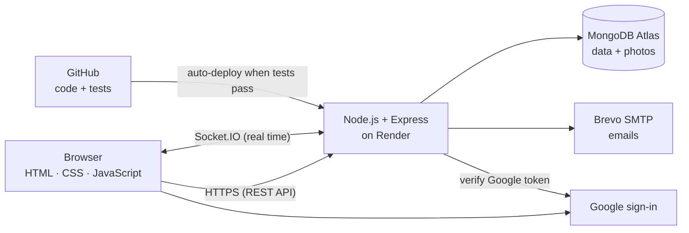

# Work Abroad Hub

**Legal part-time jobs for international students in Korea: matched to their class schedule and checked against visa and minimum-wage rules.**

**Live site:** https://work-abroad-hub.onrender.com

[](https://github.com/chishtysheikh-sketch/Work-Abroad-Hub/actions/workflows/test.yml)


> The live site runs on Render's free plan. If nobody has visited for 15 minutes, the first page load takes about a minute while the server wakes up.

---

## 1. The problem and who it is for

About 200,000 international students study in Korea, mostly on **D-2 (degree)** and **D-4 (Korean language)** visas. Many need part-time work, but:

- the weekly hour limit depends on the visa, the year of study **and the TOPIK level**, and going over it can cost a student their visa;
- some job ads pay less than the legal minimum wage;
- general job sites are in Korean and don't show if a job fits a student's class timetable.

Work Abroad Hub has three kinds of users:

| User | What they do on the site |
|---|---|
| **Students** (D-2 / D-4) | Find jobs that fit their free time, apply, and track their weekly work hours against their visa limit |
| **Employers** | Post jobs, receive applications, chat with applicants |
| **Admin** | Verify employers, hide bad job posts, handle user reports |

## 2. Main features

**Students**
- Job board with search, filters and a map
- **Match %** for every job, based on free time (40 %), distance from home (25 %), hourly pay (20 %) and Korean level (15 %)
- Apply in one click; follow each application: Applied → Contacted → Interview → Hired
- Dashboard: stats, saved jobs, top matches, weekly free-time planner
- **Visa work-hours tracker** with a gauge that warns before the weekly limit
- Chat with employers, notifications, work-permit (HiKorea) guide, "download my data"

**Employers**
- Company profile with a 10-digit business registration number
- Post, edit, close and reopen jobs; pay below the minimum wage is blocked
- Dashboard with charts, job status and "expiring soon"; every card opens a filtered list
- Manage applicants (status, chat), live notifications

**Admin** (`/admin.html`)
- Verify employers ("✓ Verified employer" badge on their jobs), optional National Tax Service lookup
- Hide job posts, block users, handle reports; every admin action is logged

**Everyone**
- English and Korean, light and dark mode, works on phones
- Installable as an app (PWA), partly works offline

## 3. Screenshots

| Home | Student dashboard | Employer dashboard |
|---|---|---|
|  |  |  |

| Chat | Admin panel | Mobile |
|---|---|---|
|  |  |  |

## 4. Architecture



- The **website** (`public/`) is plain HTML, CSS and JavaScript. It talks to the server through a small connector (`public/wah-fb.js`).
- The **server** (`src/`) checks who the user is and whether they are allowed to read or change the data, then reads or writes MongoDB.
- **Socket.IO** pushes changes (new applicant, new message, status update) to open browsers immediately.
- Every push to GitHub runs the tests; Render deploys only when they pass.

## 5. Tech stack

| Tool | What for | Why |
|---|---|---|
| **HTML, CSS, JavaScript** (no framework) | The website | Fast to load, nothing to compile, easy to read |
| **Node.js 22+ / Express 5** | Server and REST API | One language (JavaScript) for the whole project |
| **MongoDB Atlas + Mongoose** | Database (photos in GridFS) | Flexible documents fit job posts and profiles; free cloud tier |
| **Socket.IO** | Real-time updates and chat | Works through firewalls and reconnects by itself |
| **bcryptjs, jsonwebtoken** | Passwords and login sessions | Industry-standard hashing and signed tokens |
| **Nodemailer + Brevo** | Verification codes, password reset, notifications | Any SMTP provider works; Brevo's free plan is enough |
| **google-auth-library** | "Sign in with Google" | Checks Google's token on the server |
| **helmet, express-rate-limit, zod** | Security headers, rate limits, input and settings checks | Small, well-known libraries |
| **sharp, multer** | Photo and logo uploads | Resize, remove location data, convert to WebP |
| **Leaflet + OpenStreetMap** | Job map | Free, no API key |
| **pino** | Logs and error alerts | Fast, structured logs |
| **Vitest, Supertest, Playwright** | Automatic tests (server and real browser) | Catch bugs before they reach the live site |
| **GitHub Actions** | Runs all tests on every push | Free CI |
| **Render** | Hosting | Free plan, HTTPS and auto-deploy built in; supports WebSockets |

## 6. Security

- **Passwords** are hashed with **bcrypt**; they are never stored or logged in plain text. Password strength is checked.
- **Login session** is a signed **JWT in an httpOnly cookie** (`SameSite=Lax`, `Secure` in production): page scripts can't read it. "Log out everywhere" and password changes end all other sessions.
- **Server-side rules** (`src/fb/rules.js`) check every read and write: a user can only change their own data, students can't post jobs, closed jobs are hidden from the public, and so on. Nothing depends on the browser behaving.
- **Rate limits** on login, sign-up, codes, writes, uploads and reports; accounts lock for a while after repeated wrong passwords.
- **Content Security Policy** (helmet): the browser only runs scripts from our own site and a short list of trusted sources.
- **Email verification** with a 6-digit code (30 minutes, 5 tries) before a user can post or apply; Korean mobile numbers must start with 010 (optional SMS code).
- **Upload checks**: 5 MB maximum, the real file type is read from the file's bytes (JPEG / PNG / WebP only), images are resized and re-encoded, and all metadata (such as GPS location) is removed.
- Secrets live only in `.env` (never committed) and in Render's settings. Daily encrypted backups (AES-256-GCM) run on GitHub Actions.

More detail: [docs/SECURITY.md](docs/SECURITY.md).

## 7. Korea-specific rules

**Minimum wage.** Job posts below the legal hourly minimum are refused, on the website and again on the server. The rate comes from a yearly table (2025: ₩10,030, **2026: ₩10,320**) in `src/utils/pay.js` and uses the date in Korea. If a new year is missing, the server warns on every start.

**Visa work-hour limits** (weekly limit during the semester; shown in the hours tracker):

| Student | TOPIK needed | Limit below that level | Limit at that level | Weekends / vacation |
|---|---|---|---|---|
| Korean language course (D-4) | 2 | 10 h | 20 h | counted |
| Undergraduate, year 1–2 (D-2) | 3 | 10 h | 25 h | unlimited |
| Undergraduate, year 3–4 (D-2) | 4 | 10 h | 25 h | unlimited |
| Master's / PhD (D-2) | 4 | 15 h | 30 h | unlimited |

Students still need an immigration **part-time work permit** before their first shift; the site explains the steps and links to HiKorea. These rules are a guide; students should confirm with their university's international office.

**Business registration number.** Employers must enter a 10-digit 사업자등록번호; it is saved as `123-45-67890`. Admins can check it with the National Tax Service API.

## 8. Run it on your computer

**You need:** [Node.js 22 or newer](https://nodejs.org) and MongoDB (install [MongoDB Community](https://www.mongodb.com/try/download/community) locally, or use a free [MongoDB Atlas](https://www.mongodb.com/atlas) cluster).

```bash
git clone https://github.com/chishtysheikh-sketch/Work-Abroad-Hub.git
cd Work-Abroad-Hub
npm install
cp .env.example .env        # then open .env and fill in the values below
npm run dev
```

Open **http://localhost:4000**.

**Settings in `.env`** (only the first two are required to start):

| Key | What it is |
|---|---|
| `MONGODB_URI` | Database address, e.g. `mongodb://127.0.0.1:27017/workabroadhub` or your Atlas string |
| `JWT_SECRET` | Long random text (32+ characters) used to sign logins |
| `PORT` | Port of the server (default 4000) |
| `NODE_ENV` | `development` on your computer, `production` on the live server |
| `APP_URL` | The site's address, used in email links (default `http://localhost:4000`) |
| `SMTP_HOST`, `SMTP_PORT`, `SMTP_USER`, `SMTP_PASS`, `MAIL_FROM` | Email account for sending codes. Leave empty locally: codes are printed in the terminal |
| `GOOGLE_CLIENT_ID`, `GOOGLE_CLIENT_SECRET` | Google sign-in (optional; the Google button is hidden without them) |
| `NTS_API_KEY` | National Tax Service business lookup from data.go.kr (optional) |
| `SOLAPI_API_KEY`, `SOLAPI_API_SECRET`, `SMS_FROM` | SMS codes for phone numbers (optional) |
| `ALERT_WEBHOOK_URL` | Slack/Discord webhook for error alerts (optional) |
| `LOG_LEVEL` | How much the server logs (optional, default `info`) |

**Tests**

```bash
npm test             # 123 server tests (uses a temporary in-memory database; no setup needed)
npx playwright install chromium && npm run test:e2e   # 5 browser tests that click through the real site
```

## 9. Project structure

```
src/                     the server
├── server.js, app.js    start-up, security headers, caching, serves public/
├── config/              reads and checks .env, connects to MongoDB
├── routes/              API: login + data (fb.routes), images, notifications, reports, admin
├── fb/                  data access and the security rules (rules.js)
├── models/              database shapes: User, FbDoc, Notification, Report, AdminLog
├── sockets/             Socket.IO real-time updates
├── middleware/          login check, admin check, error handling
├── services/            notifications (in-app + email)
└── utils/               email, passwords, sessions, images, minimum wage, business number, SMS, logs

public/                  the website
├── index.html           job board, sign-up, student + employer dashboards
├── script.js            all page logic
├── style.css            design, dark mode, phone layout
├── wah-fb.js            connector between the website and the server
├── admin.html / .js     admin panel
├── sw.js, manifest      installable app (PWA) and offline page
└── icons/               app icons

tests/                   server tests (Vitest)     e2e/   browser tests (Playwright)
scripts/                 backup, restore, email test, maintenance     docs/   deployment and security notes
```

## 10. Deployment

1. **MongoDB Atlas:** free cluster, a database user, Network Access `0.0.0.0/0`; copy the connection string.
2. **Brevo:** create an SMTP key (Gmail with an app password also works).
3. **Render:** New → Blueprint → this repository. `render.yaml` sets everything up; paste the values it asks for.
4. Render builds and starts the server; every push to `main` that passes the tests deploys again.
5. Health check: `https://work-abroad-hub.onrender.com/api/health`. Step-by-step guide: [docs/DEPLOY.md](docs/DEPLOY.md).

## 11. Limitations and future work

**Limitations**
- Free hosting: the server sleeps after 15 idle minutes, so the first visit is slow.
- Visa rules are typed into the code and must be updated by hand when the law changes (minimum wage every January).
- The business number is only format-checked unless the NTS API key is set; SMS phone codes need a paid provider.
- Jobs open inside the home page, so search engines only see one page.

**Future work**
- Native mobile app and push notifications
- A separate page (URL) for each job, so Google can list jobs individually
- Contract templates and automatic permit document checklist
- Reviews of employers by students; reports for universities
- More languages (Vietnamese, Uzbek, Mongolian, Chinese)

## 12. Author

**Chishty Sheikh**, capstone project, 2026.
